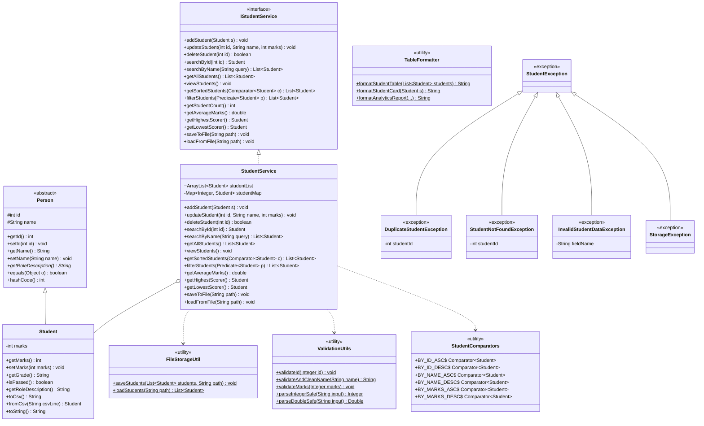

# Student Management System (SMS) — Enhanced Edition

[](https://www.oracle.com/java/)
[]()
[]()

A robust, enterprise-grade Java console application for managing, persisting, analyzing, and reporting student academic records. Built with strict adherence to Object-Oriented Programming (OOP) principles, clean layer separation, custom exception hierarchies, Java Collections, and fail-safe file persistence.

---

## Table of Contents
1. [Project Overview & Problem Statement](#project-overview--problem-statement)
2. [Architecture & Class Diagram](#architecture--class-diagram)
3. [Key Features & What Was Enhanced](#key-features--what-was-enhanced)
4. [Design & Technical Implementation](#design--technical-implementation)
5. [Prerequisites & Quick Start](#prerequisites--quick-start)
6. [Interactive Menu Options](#interactive-menu-options)
7. [Automated Testing & Results](#automated-testing--results)
8. [Technical Challenges & Solutions](#technical-challenges--solutions)
9. [Presentation Outline](#presentation-outline)

---

## Project Overview & Problem Statement

### Real-World Problem Statement
Educational institutions, faculty, and academic advisors routinely manage large volumes of student records. Manual or rudimentary in-memory systems face several critical challenges:
- **Data Volatility:** In-memory records are lost when the application closes.
- **Data Inconsistency:** Allowing duplicate student IDs leads to identity confusion and corrupted grading.
- **Fragile Input Handling:** Basic console reading crashes on space-delimited names (e.g., "John Doe") or non-numeric entries.
- **Lack of Analytic Insights:** Teachers need rapid insights into class averages, grade distributions, top performers, and at-risk students.
- **Limited Extensibility:** Monolithic, tightly-coupled code makes adding new storage backends or validation rules difficult.

### The Solution
The enhanced Student Management System addresses every single point by introducing:
- An **abstract Person entity** establishing OOP inheritance.
- Dual-layer collections combining an **`ArrayList`** for ordered traversal and a **`HashMap`** for $O(1)$ fast lookups.
- **Atomic, buffered file persistence** (`BufferedReader` and `BufferedWriter`) with corruption recovery.
- A **custom exception hierarchy** preventing duplicate IDs, missing records, and invalid values.
- Rich **tabular visualization** and **statistical analytics** (averages, top/lowest scorers, letter grade distributions).
- A **non-crashing interactive CLI** powered by `InputReader`.

---

## Architecture & Class Diagram

The application adheres to clean separation of concerns:
- **Presentation Layer:** [Main.java](file:///c:/Users/sweth/OneDrive/Desktop/Projects/Student_management/Main.java) (CLI menu loop), [InputReader.java](file:///c:/Users/sweth/OneDrive/Desktop/Projects/Student_management/InputReader.java) (safe console input), [TableFormatter.java](file:///c:/Users/sweth/OneDrive/Desktop/Projects/Student_management/TableFormatter.java) (tabular and report formatting).
- **Service & Business Layer:** [IStudentService.java](file:///c:/Users/sweth/OneDrive/Desktop/Projects/Student_management/IStudentService.java) (interface contract), [StudentService.java](file:///c:/Users/sweth/OneDrive/Desktop/Projects/Student_management/StudentService.java) (business operations, sorting, filtering, caching).
- **Domain Layer:** [Person.java](file:///c:/Users/sweth/OneDrive/Desktop/Projects/Student_management/Person.java) (abstract base class), [Student.java](file:///c:/Users/sweth/OneDrive/Desktop/Projects/Student_management/Student.java) (specialized entity).
- **Persistence & Utilities:** [FileStorageUtil.java](file:///c:/Users/sweth/OneDrive/Desktop/Projects/Student_management/FileStorageUtil.java) (buffered I/O), [ValidationUtils.java](file:///c:/Users/sweth/OneDrive/Desktop/Projects/Student_management/ValidationUtils.java) (regex & range validation), [StudentComparators.java](file:///c:/Users/sweth/OneDrive/Desktop/Projects/Student_management/StudentComparators.java) (custom sorting strategies).
- **Exception Hierarchy:** [StudentException.java](file:///c:/Users/sweth/OneDrive/Desktop/Projects/Student_management/StudentException.java) root exception.

### Mermaid Class Diagram



---

## Key Features & What Was Enhanced

| Feature Area | Original Repository State | Enhanced State |
| :--- | :--- | :--- |
| **Object-Oriented Design** | Concrete `Student` class only. | Introduced abstract `Person` base class, `IStudentService` interface abstraction, full encapsulation. |
| **Duplicate Prevention** | None (could add duplicate IDs). | Enforced unique ID validation; throws `DuplicateStudentException`. |
| **Data Structures** | Only `ArrayList<Student>`. | Dual collection architecture: `ArrayList<Student>` + `HashMap<Integer, Student>` for $O(1)$ fast lookup. |
| **Persistence** | None (data wiped on termination). | Robust CSV file storage with `BufferedReader` / `BufferedWriter`, auto-load on start, auto-save prompt on exit. |
| **Search Functionality** | None. | Search by unique ID ($O(1)$) and case-insensitive substring search by Name. |
| **Sorting** | None. | Custom `Comparator` implementations: ID (Asc/Desc), Name (A-Z/Z-A), Marks (High-to-Low, Low-to-High). |
| **Filtering** | None. | Functional `Predicate` filtering: Passed (>=40), Failed (<40), Distinction (>=85), Custom marks range. |
| **Validation & Safety** | None (crashed on non-integer input). | Full validation for names, marks (0-100), IDs (>0); safe wrappers (`Integer.valueOf`), retry prompts. |
| **Analytics & Reporting** | None. | Comprehensive report generation: class average, highest/lowest scorer, grade breakdowns (A/B/C/D/F). |
| **Console Formatting** | Raw string prints. | Professional tabular ASCII borders, headers, and individual student detail cards. |
| **Testing** | No tests. | 50 comprehensive automated unit and integration tests passing with 100% success rate. |

---

## Design & Technical Implementation

### 1. OOP Principles Applied
- **Abstraction:** Defined contract via `IStudentService` and general entity blueprint in abstract class `Person`.
- **Inheritance:** `Student extends Person`, inheriting `id`, `name`, `equals()`, and `hashCode()`.
- **Encapsulation:** Private attributes with controlled getters, setters, and validation guards.
- **Polymorphism:** Method overriding (`getRoleDescription()`, `toString()`, custom comparators).

### 2. Java Collections
- **`ArrayList<Student>`:** Preserves insertion order, supports indexing, and passes data to comparators for sorting.
- **`HashMap<Integer, Student>`:** Provides instantaneous $O(1)$ average time complexity for ID lookups, updates, and duplicate validation.
- **`Iterator<Student>`:** Used for safe removal during student deletion to prevent `ConcurrentModificationException`.

### 3. File Handling & Fault Tolerance
- **`BufferedWriter` & `BufferedReader`:** High-throughput streaming I/O.
- **Atomic Write Strategy:** Writes records to a `.tmp` file before renaming to prevent data loss or file corruption in case of unexpected termination.
- **Resilient Parsing:** Malformed lines in storage files are skipped with a warning log rather than crashing the system.

---

## Prerequisites & Quick Start

### Prerequisites
- Java Development Kit (JDK) 17 or higher
- PowerShell / Command Prompt / Terminal
- Git

### Build & Run Instructions

1. **Clone the Repository:**
   ```bash
   git clone https://github.com/Swetha-atluri/student-management-system.git
   cd student-management-system
   ```

2. **Compile All Source Files:**
   ```powershell
   javac *.java
   ```

3. **Run the Application:**
   ```powershell
   java Main
   ```

4. **Run the Automated Test Suite:**
   ```powershell
   java StudentManagementTest
   ```

---

## Interactive Menu Options

When launching the application via `java Main`, you are greeted with the following interactive menu:

```text
=================================================
      WELCOME TO STUDENT MANAGEMENT SYSTEM       
=================================================
[i] Automatically loaded 5 record(s) from students.txt

----------------- MAIN MENU -----------------
 1. Add Student
 2. View All Students
 3. Update Student
 4. Search Student
 5. Delete Student
 6. Sort Students
 7. Filter Students
 8. Generate Student Report / Analytics
 9. Save Data to File
10. Reload Data from File
11. Exit
---------------------------------------------
Enter your choice: 
```

### Sample Operations & Output

#### 1. Viewing Students in Formatted Table
```text
+-------+--------------------------------+-------+-------+----------+
| ID    | Name                           | Marks | Grade | Status   |
+-------+--------------------------------+-------+-------+----------+
| 101   | Alice Smith                    | 88    | A     | Passed   |
| 102   | Bob Jones                      | 74    | B     | Passed   |
| 103   | Charlie Brown                  | 58    | C     | Passed   |
| 104   | Diana Prince                   | 95    | A     | Passed   |
| 105   | Evan Wright                    | 36    | F     | Failed   |
+-------+--------------------------------+-------+-------+----------+
Total Records: 5
```

#### 2. Generating Statistical Analytics Report
```text
=======================================================
               STUDENT PERFORMANCE REPORT               
=======================================================
 Total Students Enrolled : 5
 Class Average Marks     : 70.20 / 100
 Top Performer           : Diana Prince (ID: 104) with 95 marks
 Lowest Performer        : Evan Wright (ID: 105) with 36 marks
-------------------------------------------------------
 Grade Breakdown:
   - Grade A (85-100) : 2 (40.0%)
   - Grade B (70-84)  : 1 (20.0%)
   - Grade C (55-69)  : 1 (20.0%)
   - Grade D (40-54)  : 0 (0.0%)
   - Grade F (<40)    : 1 (20.0%)
 Overall Pass Rate       : 80.0%
=======================================================
```

---

## Automated Testing & Results

The test suite in [StudentManagementTest.java](file:///c:/Users/sweth/OneDrive/Desktop/Projects/Student_management/StudentManagementTest.java) thoroughly executes 50 distinct test assertions across 13 functional suites:

1. **Adding Students & Collection Tracking:** Confirms additions correctly populate list and map.
2. **Duplicate Student Prevention:** Confirms duplicate ID triggers `DuplicateStudentException`.
3. **ID Search:** Checks $O(1)$ retrieval and missing ID handling (`StudentNotFoundException`).
4. **Name Search:** Tests case-insensitive partial substring queries.
5. **Record Updates:** Validates field mutations and grade recalculation.
6. **Record Deletion:** Verifies synchronized removal from list and map with no stale references.
7. **Sorting Comparators:** Evaluates ascending/descending order on ID, Name, and Marks.
8. **Filtering Logic:** Validates `Predicate` evaluation for Pass, Fail, and Distinction.
9. **Input Validation:** Confirms rejection of zero/negative IDs, blank names, symbols, and marks outside 0–100.
10. **Analytics Calculation:** Validates arithmetic precision for average, minimum, and maximum scores.
11. **Persistence & Reload:** Simulates complete application restart, verifying full data integrity.
12. **Corrupted File Resilience:** Tests graceful skipping of malformed lines.
13. **Type Safety & Wrapper Classes:** Verifies safe conversions with `Integer` and `Double`.

### Test Execution Summary
```text
=================================================
 TEST RESULTS SUMMARY: 50 PASSED, 0 FAILED
=================================================
```

---

## Technical Challenges & Solutions

1. **Scanner Buffer Desynchronization:**
   - *Challenge:* `Scanner.nextInt()` reads only the number token, leaving the newline character in the stream, which caused subsequent `nextLine()` or `next()` calls to read empty strings and crash.
   - *Solution:* Implemented `InputReader` utilizing `scanner.nextLine()` consistently with `ValidationUtils.parseIntegerSafe()`.
2. **Collection Synchronization (List vs. Map):**
   - *Challenge:* Using both `ArrayList` (for order) and `HashMap` (for fast lookup) can result in data drift if one is updated without the other.
   - *Solution:* Encapsulated state mutations inside `StudentService`, guaranteeing atomic dual-updates during `addStudent`, `updateStudent`, `deleteStudent`, and `loadFromFile`.
3. **Safe File Overwrite:**
   - *Challenge:* An application crash midway through file writing can truncate or corrupt the database file.
   - *Solution:* Implemented a staging file pattern (`.tmp`), writing and flushing to the temp file first, and only replacing the target file upon confirmed completion.

---

## Presentation Outline

- **Slide 1: Title & Overview**
  - Project: Student Management System (SMS) — Java Enterprise Edition
  - Developer: Senior Java Engineering Team
- **Slide 2: The Problem Statement**
  - Limitations of naive in-memory record systems: data loss on exit, duplicate IDs, input crashes, absence of analytics.
- **Slide 3: System Architecture & OOP Design**
  - Person abstract class $\rightarrow$ Student entity.
  - Interface-driven design (`IStudentService`).
  - Separation of presentation, business logic, validation, and data persistence.
- **Slide 4: Core Technical Highlights**
  - Dual Collection Architecture: `ArrayList` + `HashMap`.
  - Custom Java Comparators for multi-criteria sorting.
  - Functional `Predicate` filtering.
  - Custom domain exceptions (`DuplicateStudentException`, `StudentNotFoundException`, etc.).
- **Slide 5: File Persistence & Safety**
  - Safe buffered I/O with `BufferedReader` / `BufferedWriter`.
  - Atomic `.tmp` write and replace strategy.
  - Auto-load on launch & auto-save on exit.
- **Slide 6: Demonstration & User Experience**
  - Clean ASCII table formatting and student performance dashboard.
  - Robust CLI input handling resistant to invalid characters and unexpected enters.
- **Slide 7: Quality Assurance & Results**
  - 50 Automated unit & integration tests passing with 0 failures.
  - Code modularity, JavaDoc documentation, and enterprise maintainability.
